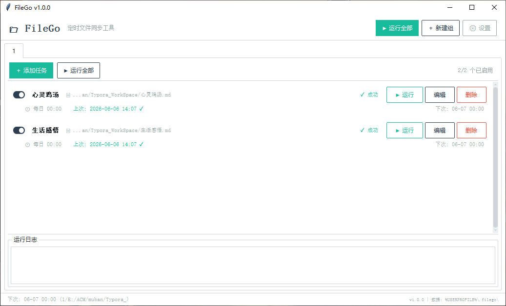
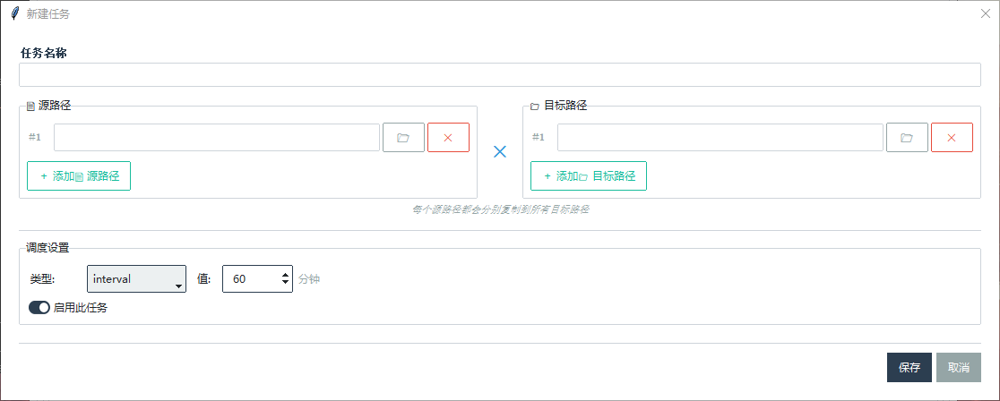

# FileGo

**FileGo** 是一款 Windows 桌面定时文件复制工具。它允许你定义多个任务组，每个任务组包含若干复制任务，按照设定的时间计划（间隔 / 每日定时 / 手动）把多个源文件或文件夹按「源 #1 → 目标 #1、源 #2 → 目标 #2」的配对方式复制到对应目标路径。

## 功能特性

- **多组 1 对 1 复制** — 每个任务可添加多组「源 → 目标」配对：源 #1 复制到目标 #1、源 #2 复制到目标 #2；源与目标数量必须一致，不会把每个源复制到所有目标
- **混合复制类型** — 编辑任务时，每条源路径可独立选择“单文件复制”或“整体备份(文件夹)”，同一任务可混合添加；旧任务自动沿用原有类型
- **文件夹整体备份** — 备份模式可选"整体备份(文件夹)"：将整个源文件夹内容同步到目标文件夹，之后新增的文件也会自动备份（非破坏性合并，不删除目标已有文件）
- **通配符支持** — 源路径支持 `*` 和 `?` 通配符匹配
- **三种调度模式**
  - **间隔模式** — 每隔 N 分钟执行一次（1–1440 分钟）
  - **每日模式** — 在指定时间（HH:MM）执行
  - **手动模式** — 仅手动触发执行
- **任务分组** — 将任务按类别组织到不同分组中
- **系统托盘** — 最小化到系统托盘，后台静默运行
- **开机自启** — 支持注册到 Windows 启动项
- **单实例运行** — 防止重复启动，再次启动会激活已有窗口
- **复制重试** — 文件复制失败时自动重试（最多 3 次，带退避延迟）
- **大文件分块复制** — 8 MB 分块读写，避免大文件复制时的元数据锁问题
- **数据持久化** — 配置和任务数据保存为 JSON 文件（原子写入，损坏自动恢复）
- **日志记录** — 运行日志写入 `%USERPROFILE%\.filego\filego.log`
- **现代 UI** — 基于 ttkbootstrap 的美观界面，支持浅色/深色主题切换（设置 → 外观）

## 预览





## 运行环境

- **操作系统：** Windows
- **Python：** 3.12+

## 快速开始

### 从源码运行

```bash
# 克隆仓库
git clone <repo-url> FileGo
cd FileGo

# 安装依赖
pip install -r requirements.txt

# 启动程序
python main.py

# 以隐藏模式启动（最小化到托盘，适用于开机自启）
python main.py --hidden
```

### 使用预构建的可执行文件

直接运行 `dist/FileGo.exe`（约 29 MB 的独立可执行文件）。

## 依赖

| 包名 | 版本 | 用途 |
|------|------|------|
| [ttkbootstrap](https://github.com/israel-dryer/ttkbootstrap) | >=1.10.0 | 现代化 tkinter 主题控件 |
| [pystray](https://github.com/moses-palmer/pystray) | >=0.19.0 | 系统托盘图标 |
| [Pillow](https://python-pillow.org/) | >=10.0.0 | 托盘图标图像处理 |

## 项目结构

```
FileGo/
├── main.py                  # 入口（DPI 设置、单实例锁、启动 App）
├── app.py                   # 应用根对象（串联所有组件）
├── config.py                # 常量、路径、日志、默认配置
├── FileGo-debug.spec        # PyInstaller 打包配置
├── requirements.txt         # Python 依赖
│
├── models/
│   ├── task.py              # Task 数据类
│   └── task_group.py        # TaskGroup 数据类
│
├── persistence/
│   └── store.py             # JSON 文件持久化（原子写入、损坏恢复）
│
├── scheduler/
│   ├── engine.py            # 调度引擎（后台线程，轮询到期任务）
│   └── executor.py          # 执行器（后台线程，消费任务队列执行复制）
│
├── services/
│   ├── file_copy.py         # 核心复制逻辑（按序号 1 对 1 配对、通配符、重试）
│   ├── single_instance.py   # 单实例锁（localhost socket）
│   └── autostart.py         # Windows 注册表开机自启管理
│
├── ui/
│   ├── main_window.py       # 主窗口（ttkbootstrap、标签页、状态栏）
│   ├── tray.py              # 系统托盘图标和菜单
│   ├── dialogs.py           # 任务编辑、分组编辑、设置对话框
│   ├── group_panel.py       # 分组面板（可滚动的任务卡片列表 + 日志）
│   ├── task_row.py          # 单个任务卡片控件
│   └── icons.py             # Base64 编码的托盘图标
│
└── resources/
    └── icon.ico             # 应用图标
```

## 构建

> **打包请使用 Python 3.12。** Python 3.14 官方安装包的 Tcl/Tk 9 使用 zipfs 内置资源，PyInstaller 暂时无法收集其 Tcl/Tk 数据目录，打出的 exe 启动会报 `Tcl data directory ... not found`（源码运行不受影响）。`build.bat` 会固定用 `py -3.12` 构建。

一键打包（推荐，会自动停止正在运行的 FileGo 再构建）：

```bash
build.bat
```

或使用 PyInstaller 直接打包：

```bash
py -3.12 -m PyInstaller --noconfirm --clean FileGo-debug.spec
```

构建产物输出到 `dist/` 目录。

## 数据存储

所有数据存储在 `%USERPROFILE%\.filego\` 目录下：

| 文件 | 说明 |
|------|------|
| `tasks.json` | 任务组和任务数据 |
| `config.json` | 应用配置 |
| `filego.log` | 运行日志 |

## 许可证

MIT License
